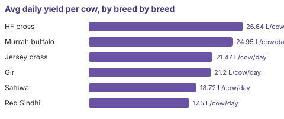

# Analyst report — barnboard

_5 question(s) over the governed semantic layer._

## What is cow-days recorded?

**Metric:** `cow_days_recorded` (count, data-designer, v1) — Data-quality metric: number of cow-days with at least one milk log. Against herd size x days it shows logging coverage. Added via JSON definition alone — zero engine changes (D2.2).

**Answer:** 220 cow-days

receipt · lineage ['gold.agg_milk_cow_daily', 'silver.milk_logs'] · `SELECT count("litres") AS "cow_days_recorded" FROM "agg_milk_cow_daily"`

## What is the avg daily yield per cow?

**Metric:** `avg_daily_yield_per_cow` (derived, data-designer, v1) — Average litres one cow gives in one day (AM+PM). Computed as total litres divided by cow-days at the cow-day grain — never by summing per-cow averages.

**Answer:** 23.16 L/cow/day

receipt · lineage ['gold.agg_milk_cow_daily', 'silver.milk_logs', 'silver.cows'] · `SELECT sum("litres")*1.0/nullif(count(*),0) AS "avg_daily_yield_per_cow" FROM "agg_milk_cow_daily"`

## Show avg daily yield per cow, by breed

**Metric:** `yield_by_breed` (derived, data-designer, v1) — avg_daily_yield_per_cow sliced by the breed dimension. Ratio class: recomputed per group, never summed up a grain.

| breed | yield_by_breed |
|---|---|
| HF cross | 26.64 |
| Murrah buffalo | 24.95 |
| Jersey cross | 21.47 |
| Gir | 21.2 |
| Sahiwal | 18.72 |
| Red Sindhi | 17.5 |

receipt · lineage ['gold.agg_milk_cow_daily', 'silver.milk_logs', 'silver.cows'] · `SELECT "breed", sum("litres")*1.0/nullif(count(*),0) AS "yield_by_breed" FROM "agg_milk_cow_daily" GROUP BY "breed" ORDER BY "yield_by_breed" DESC LIMIT 10`

## What is total milk sales revenue?

**Metric:** `milk_revenue` (derived, data-designer, v1) — Rupees received for milk: sum of litres times price per litre across collections. Additive in rupee terms; computed from components, never from a pre-averaged price.

**Answer:** 196,135 INR

receipt · lineage ['gold.agg_sales_daily', 'silver.sales'] · `SELECT sum("litres"*"price_per_litre") AS "milk_revenue" FROM "agg_sales_daily"`

## What is the avg price per litre?

**Metric:** `price_per_litre` (derived, data-designer, v2) — Volume-weighted average rupees per litre: total revenue divided by total litres. AUTHORED OVERRIDE of the auto-proposed sum — a price is a ratio and must be recomputed, never summed (the governance guard exists for exactly this).

**Answer:** 42.24 INR/L

receipt · lineage ['gold.agg_sales_daily', 'silver.sales'] · `SELECT sum("litres"*"price_per_litre")*1.0/nullif(sum("litres"),0) AS "price_per_litre" FROM "agg_sales_daily"`

